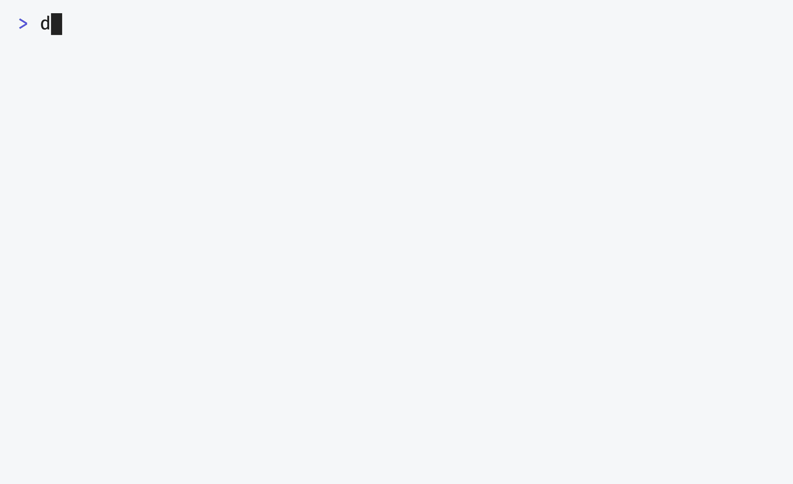
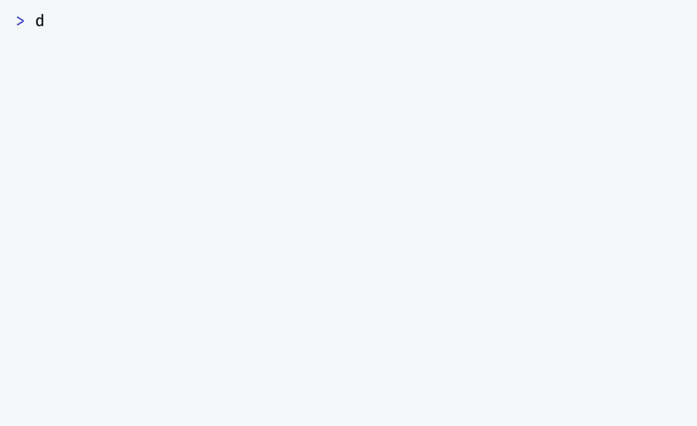

<h1 align="center">dorg</h1>

<div align="center">

**🚥 Organize macOS Dock Items**

<br />

[](https://github.com/5ouma/dorg/releases)

[](https://pkg.go.dev/github.com/5ouma/dorg)
<br />
[](https://github.com/5ouma/dorg/actions/workflows/ci.yml)
[](https://github.com/5ouma/dorg/actions/workflows/release.yml)
[](https://github.com/5ouma/utils/actions/workflows/dorg.yml)
[](https://codecov.io/gh/5ouma/dorg)


</div>

<br /><br />

## 📥 Installation

- 🍺 Homebrew

  ```sh
  brew install 5ouma/tap/dorg
  ```

<br />

- 🐹 Go

  ```sh
  go install github.com/5ouma/dorg@latest
  ```

<br />

- 🐙 [GitHub Releases](https://github.com/5ouma/dorg/releases)

  ```sh
  curl -L "https://github.com/5ouma/dorg/releases/latest/download/dorg_$(uname)_$(uname -m).tar.gz" | tar -x 'dorg'
  ```

  ```sh
  gh release download -R='5ouma/dorg' -p="dorg_$(uname)_$(uname -m).tar.gz"
  tar -xf "dorg_$(uname)_$(uname -m).tar.gz" 'dorg'
  ```

<br /><br />

## 📊 Usage

```sh
🚥 Organize macOS Dock Items with YAML

Usage:
  dorg [command]

Available Commands:
  check       Check Dock items
  help        Help about any command
  load        Load Dock items
  save        Save Dock items

Flags:
  -h, --help      help for dorg
  -v, --version   version for dorg

Use "dorg [command] --help" for more information about a command.
```

<br /><br />

## 🕹️ Commands

### 📂 `Load`

```sh
📂 Load Dock items and settings from YAML file

Usage:
  dorg load [flags]

Flags:
      --file string   config file (default "dorg.yml")
  -h, --help          help for load
  -V, --verbose       verbose output
```

<div align="center">
  <picture>
    <source
      srcset="https://raw.githubusercontent.com/5ouma/dorg/HEAD/docs/assets/vhs/light/load.gif"
      media="(prefers-color-scheme: light)"
    />
    <source
      srcset="https://raw.githubusercontent.com/5ouma/dorg/HEAD/docs/assets/vhs/dark/load.gif"
      media="(prefers-color-scheme: dark)"
    />
    
  </picture>
</div>

<br />

### 💾 `Save`

```sh
💾 Save the current Dock items and settings to YAML file

Usage:
  dorg save [flags]

Flags:
      --file string   config file (default "dorg.yml")
  -h, --help          help for save
  -V, --verbose       verbose output
```

<div align="center">
  <picture>
    <source
      srcset="https://raw.githubusercontent.com/5ouma/dorg/HEAD/docs/assets/vhs/light/save.gif"
      media="(prefers-color-scheme: light)"
    />
    <source
      srcset="https://raw.githubusercontent.com/5ouma/dorg/HEAD/docs/assets/vhs/dark/save.gif"
      media="(prefers-color-scheme: dark)"
    />
    
  </picture>
</div>

<br />

### 🔍 `Check`

```sh
🔍 Check the current Dock items are up-to-date

Usage:
  dorg check [flags]

Flags:
      --file string   config file (default "dorg.yml")
  -h, --help          help for check
  -V, --verbose       verbose output
```

<div align="center">
  <picture>
    <source
      srcset="https://raw.githubusercontent.com/5ouma/dorg/HEAD/docs/assets/vhs/light/check.gif"
      media="(prefers-color-scheme: light)"
    />
    <source
      srcset="https://raw.githubusercontent.com/5ouma/dorg/HEAD/docs/assets/vhs/dark/check.gif"
      media="(prefers-color-scheme: dark)"
    />
    
  </picture>
</div>

<br /><br />

## 🆘 Help

- [**⚠️ Issues**]: Feature Requests or Bug Reports
- [**💬 Discussions**]: General Chats or Questions
- [**🛡️ Security Advisories**]: Security Issues that should not be public

[**⚠️ Issues**]: https://github.com/5ouma/dorg/issues/new/choose
[**💬 Discussions**]: https://github.com/5ouma/dorg/discussions/new/choose
[**🛡️ Security Advisories**]: https://github.com/5ouma/dorg/security/advisories/new

<br /><br />

## 🎽 Contributing

I happily welcome your contributions! Before you contribute, I would recommend
reading [CONTRIBUTING.md](../.github/CONTRIBUTING.md) for a better development
experience.

<br /><br />

## 🎉 Acknowledgments

This project is a fork of
[🚀 **blacktop / lporg**](https://github.com/blacktop/lporg).
